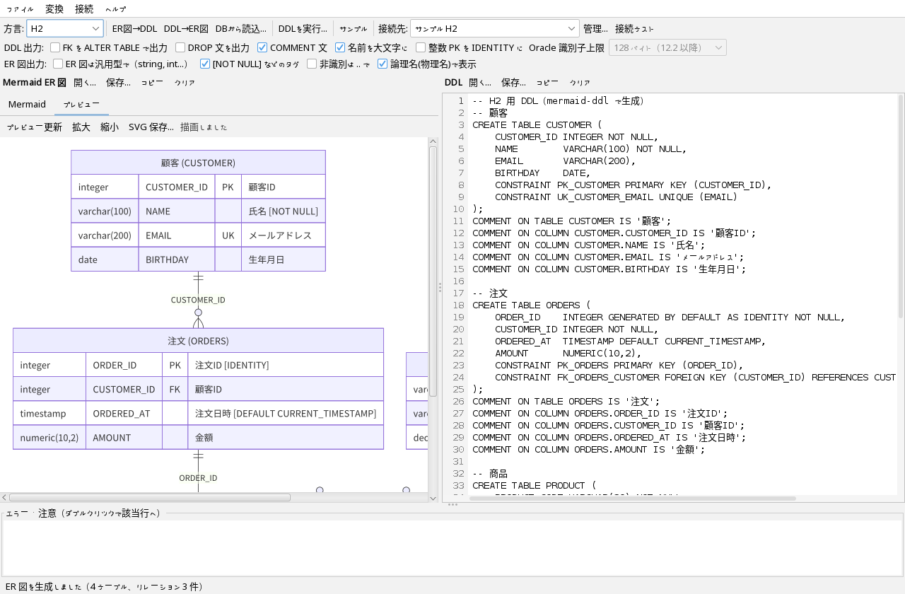
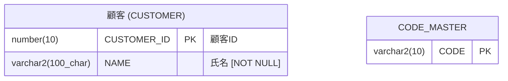

# mermaid-ddl

**Mermaid の ER 図（`erDiagram`）と DDL を相互変換する**デスクトップアプリです。対応 DB は **H2 と Oracle** です。

- ER 図 → DDL（CREATE TABLE・主キー／一意／外部キー制約・COMMENT ON）
- DDL → ER 図（SQL Developer などが出力した DDL をそのまま貼り付け可）
- 接続中の DB（H2 / Oracle）のテーブル定義から ER 図と DDL を作成、生成した DDL をその場で実行
- ER 図のプレビュー（Mermaid 12.3.0 を同梱。インターネット接続は不要）
- 技術: Java 17+ / Groovy 4 / Maven / Swing + FlatLaf / RSyntaxTextArea（エディタ） / JavaFX WebView（プレビュー用。Swing に JFXPanel で埋め込み）



---

## 1. 起動方法（Windows）

### 必要なもの

- **Java 17 以上**（例: [Eclipse Temurin 21](https://adoptium.net/ja/)。インストール時に「PATH に追加」を有効に）
- ビルドする場合のみ **Maven 3.9 以上**（[Apache Maven](https://maven.apache.org/download.cgi) を展開して `bin` を PATH に追加）

コマンドプロンプトで確認:

```bat
java -version
mvn -v
```

### A. 同梱の Windows 用 JAR をそのまま使う（ビルド不要）

1. zip を展開します（例: `C:\mermaid-ddl`）。
2. `run.bat` をダブルクリック、またはコマンドプロンプトで:
   ```bat
   cd C:\mermaid-ddl
   java -jar dist\mermaid-ddl-1.0.0-win.jar
   ```

### B. 自分でビルドして使う

```bat
cd C:\mermaid-ddl
mvn package
java -jar target\mermaid-ddl-1.0.0-all.jar
```

`target\mermaid-ddl-1.0.0-all.jar` が全部入りの実行可能 JAR です（ビルドした OS 用の JavaFX が自動で入ります）。
開発中は `mvn compile exec:java` でも起動できます。

> 起動時に `WARNING: Unsupported JavaFX configuration: classes were loaded from 'unnamed module'` と表示されますが、
> fat JAR で JavaFX を使う場合の既知の警告で、動作に問題はありません。

Linux / macOS は `./run.sh`（または `java -jar target/mermaid-ddl-1.0.0-all.jar`）で起動します。

---

## 2. 画面の使い方

| 部品 | 説明 |
|---|---|
| 左「Mermaid」タブ | erDiagram のエディタ（行番号・色分け付き）。起動時はサンプルの ER 図が入っています |
| 左「プレビュー」タブ | ER 図を描画（拡大・縮小、SVG 保存）。描画エラーは Mermaid のメッセージを表示 |
| 右「DDL」 | DDL のエディタ（行番号・SQL の色分け付き。Oracle / H2 の型やキーワードに対応） |
| 方言 | H2 / Oracle（接続先を切り替えると自動で合わせます） |
| **ER図→DDL**（F5） | 左の ER 図から右に DDL を出力 |
| **DDL→ER図**（F6） | 右の DDL（CREATE TABLE / ALTER TABLE / COMMENT ON）から左に ER 図を出力 |
| **DBから読込...** | 選択中の接続先のスキーマとテーブルを選んで、ER 図と DDL を作成 |
| **DDLを実行...** | 右の DDL を選択中の接続先で実行（確認ダイアログあり。DROP があると警告。存在しない表の DROP エラーは無視） |
| サンプル | サンプルの ER 図（顧客・注文・注文明細・商品）を表示 |
| 接続先 / 管理... / 接続テスト | 「DBから読込」「DDLを実行」で使う接続先（下記「3. 接続先の管理」） |
| オプション | DDL 出力・ER 図出力のオプション（「7. DDL の出力オプション」「8. DDL → ER 図」） |
| 開く / 保存 / コピー / クリア | 各エディタのファイル入出力（UTF-8。Shift_JIS のファイルも読めます。Markdown の ```` ```mermaid ```` ブロックも可）。メニュー「ファイル」からも可（Ctrl+O / Ctrl+S は Mermaid） |
| エラー・注意 | 解析エラーや変換時の注意を **行番号付き** で表示。ダブルクリックで該当行へ移動し、エラー行は赤く表示 |
| メニュー「ヘルプ」 | Mermaid erDiagram の書き方（早見表）、ログフォルダを開く、バージョン情報 |

### エディタ（シンタックスハイライト）

両方のエディタは RSyntaxTextArea（BSD 3-Clause）で、次のように色分けします。

| エディタ | 色分け |
|---|---|
| DDL | SQL のキーワード、型（`VARCHAR2` `NUMBER` `CLOB` `TIMESTAMP` `BINARY_DOUBLE` など）、`GENERATED` `IDENTITY` `TABLESPACE` `PCTFREE` `NOLOGGING` などの Oracle / H2 の句、関数（`NVL` `SYS_GUID` など）、文字列、`--` / `/* */` コメント |
| Mermaid | `erDiagram`、多重度つきの線（`\|\|--o{` など）、`PK` / `FK` / `UK`、型（`string` `varchar2(50)` など）、`"..."` の文字列と中の `[NOT NULL]` などのタグ、`` `名前` ``、`%%` コメント |

- 元に戻す / やり直し（Ctrl+Z / Ctrl+Y）、右クリックメニュー（切り取り・コピー・貼り付け・すべて選択など）、括弧の対応表示が使えます。
- エラー・注意のある行は背景を赤くし、行番号の横に赤い印を付けます（印にマウスを載せると説明）。
- 色は FlatLaf の明るい / 暗いテーマに合わせます。
- フォントは日本語も表示できる等幅フォントを自動で選びます（BIZ UDゴシック → ＭＳ ゴシック → Noto Sans Mono CJK JP など。無ければ Java の Monospaced。Monospaced は日本語の文字を別のフォントで補って表示します）。

---

## 3. 接続先の管理

ツールバーの「管理...」（メニュー「接続 → 接続先の管理...」）で、接続先の追加・複製・編集・削除・接続テストができます。
「テンプレート」で H2（ファイル / メモリ / Oracle 互換モード / サーバー）と Oracle（サービス名 / SID / TNS 別名）の URL 例を入力できます。
最後に選んだ接続先を記憶します。初回起動時は、お試し用の「サンプル H2」（`%USERPROFILE%\.mermaid-ddl\sample.mv.db`）が登録されています。

- **JDBC ドライバは H2 と Oracle（ojdbc11 + orai18n）を同梱**しています。orai18n は `JA16SJIS` など日本語文字セットの Oracle DB に必要です。
- Oracle Cloud（Autonomous DB）のウォレット接続は `jdbc:oracle:thin:@別名?TNS_ADMIN=ウォレットのフォルダ` で指定します。
- ドライバクラス欄は通常空欄で OK（URL から自動判定）。
- パスワードは AES-256-GCM で暗号化して保存します。

設定は `%USERPROFILE%\.mermaid-ddl\` に保存されます（`-Dmermaid-ddl.config=フォルダ` で変更可）。

| ファイル | 内容 |
|---|---|
| `connections.json` | 接続先一覧（パスワードは暗号化） |
| `secret.key` | 暗号鍵（初回起動時に自動生成。**削除すると保存済みパスワードは復号できなくなります**） |
| `settings.properties` | 画面のオプション（チェックボックスなど）の状態 |
| `logs/app.log` | 実行ログ（変換・DDL 実行・エラー） |

---

## 4. 変換の例

入力（Mermaid）:

```mermaid
erDiagram
    CUSTOMER["顧客"] {
        int customer_id PK "顧客ID"
        string(100) name "氏名 [NOT NULL]"
        varchar2(200) email UK "メールアドレス"
    }
    ORDERS["注文"] {
        int order_id PK "注文ID [IDENTITY]"
        int customer_id FK "顧客ID"
        number(10,2) amount "金額"
    }
    CUSTOMER ||--o{ ORDERS : "注文する"
```

出力（Oracle）:

```sql
-- 顧客
CREATE TABLE CUSTOMER (
    CUSTOMER_ID NUMBER(10) NOT NULL,
    NAME        VARCHAR2(100 CHAR) NOT NULL,
    EMAIL       VARCHAR2(200),
    CONSTRAINT PK_CUSTOMER PRIMARY KEY (CUSTOMER_ID),
    CONSTRAINT UK_CUSTOMER_EMAIL UNIQUE (EMAIL)
);
COMMENT ON TABLE CUSTOMER IS '顧客';
COMMENT ON COLUMN CUSTOMER.CUSTOMER_ID IS '顧客ID';
COMMENT ON COLUMN CUSTOMER.NAME IS '氏名';
COMMENT ON COLUMN CUSTOMER.EMAIL IS 'メールアドレス';

-- 注文
CREATE TABLE ORDERS (
    ORDER_ID    NUMBER(10) GENERATED BY DEFAULT AS IDENTITY NOT NULL,
    CUSTOMER_ID NUMBER(10) NOT NULL,
    AMOUNT      NUMBER(10,2),
    CONSTRAINT PK_ORDERS PRIMARY KEY (ORDER_ID),
    CONSTRAINT FK_ORDERS_CUSTOMER FOREIGN KEY (CUSTOMER_ID) REFERENCES CUSTOMER (CUSTOMER_ID)
);
COMMENT ON TABLE ORDERS IS '注文';
...
```

H2 を選ぶと `INTEGER` / `VARCHAR(100)` / `VARCHAR(200)` / `NUMERIC(10,2)` になります（他は同じ）。

## 5. 対応する Mermaid の書き方

| 要素 | 書き方 | DDL での意味 |
|---|---|---|
| エンティティ | `CUSTOMER`、`"LINE ITEM"`（空白入りは "..."）、`顧客`、`LINE-ITEM` | テーブル。英数字の名前は大文字化し `-` は `_` に（オプション「名前を大文字に」で切替）。それ以外は "..." 付き |
| 表示名 | `CUSTOMER["顧客"]` / `CUSTOMER[顧客]` / `CUSTOMER["顧客 (CUSTOMER)"]` | `COMMENT ON TABLE`（「論理名 (物理名)」の形なら論理名だけ。下記） |
| 属性 | `型 名前 キー "コメント"`（例: `int customer_id PK, FK "顧客ID"`） | 列 / `COMMENT ON COLUMN` |
| キー | `PK` `FK` `UK`（複数は `PK, FK`） | PK → `PRIMARY KEY`（複数列なら複合主キー、NOT NULL）、UK → `UNIQUE`、FK → 外部キー（下記） |
| リレーション | `A \|\|--o{ B : "ラベル"` | 外部キー（参照先 = 1 側） |
| 多重度 | `\|o` `\|\|` `}o` `}\|`（左）、`o\|` `\|\|` `o{` `\|{`（右）、語形 `one` `only one` `1` `zero or one` `one or more` `1+` `zero or more` `0+` `many(0)` `many(1)` | 1 側が `\|\|` なら FK 列は NOT NULL、`\|o` なら NULL 可。1 対 1 は UNIQUE を追加。多対多は警告（中間テーブルが必要） |
| 線 | `--`（識別）、`..`（非識別）、`to` / `optionally to` | DDL には影響しません |
| 無視するもの | `---` front matter（title は読む）、`%%` コメント、`direction`、`classDef` / `class` / `style`、`:::クラス`、`accTitle` / `accDescr` | |

**コメント末尾のタグ（このツールの拡張）**: Mermaid には NOT NULL や既定値の書き方がないため、コメントの最後に書きます。
Mermaid の描画ではそのままコメントとして表示されます。

| タグ | 意味 |
|---|---|
| `[NOT NULL]`（`[必須]` も可） | NOT NULL |
| `[DEFAULT 式]` | DEFAULT 式（例: `[DEFAULT 'N']` `[DEFAULT SYSDATE]` `[DEFAULT SEQ_X.NEXTVAL]` → シーケンスも作成し、H2 では `NEXT VALUE FOR` に変換） |
| `[IDENTITY]` / `[IDENTITY ALWAYS]` / `[IDENTITY ON NULL]` | `GENERATED BY DEFAULT / ALWAYS / BY DEFAULT ON NULL AS IDENTITY` |
| `[UNIQUE]` | UK と同じ |

**外部キーの推定**: リレーションの 1 側（親）の主キー列に対応する列を、多側（子）から次の順に探します。

1. 同じ名前の FK 属性（`CUSTOMER.customer_id` ← `ORDERS.customer_id FK`）
2. `親テーブル名_主キー名` の列（`CUSTOMER.id` ← `customer_id`）
3. `_主キー名` で終わる FK 属性（`USERS.user_id` ← `editor_user_id FK`）
4. 見つからず、子に未使用の FK 属性が 1 つだけならそれ（自己参照 `manager_id` など。注意を表示）

リレーションに使われなかった FK 属性は、名前が一致する主キーを持つテーブルを参照先にします（注意を表示）。
どれでも決まらない場合は外部キーを作らず、行番号付きで注意を表示します。

## 6. 型の書き方

汎用型と DB 固有の型のどちらも使えます。DB 固有の型は、同じ方言ならそのまま、別の方言なら同等の型に変換します。

| ER 図の型 | H2 | Oracle |
|---|---|---|
| `string` / `string(n)` | `VARCHAR(255)` / `VARCHAR(n)` | `VARCHAR2(255 CHAR)` / `VARCHAR2(n CHAR)` |
| `varchar2(n)` / `varchar(n)` | `VARCHAR(n)` | `VARCHAR2(n)` |
| `varchar2(n_char)` / `varchar2(n char)` | `VARCHAR(n)` | `VARCHAR2(n CHAR)` |
| `char(n)` / `nvarchar2(n)` | `CHAR(n)` / `VARCHAR(n)` | `CHAR(n)` / `NVARCHAR2(n)` |
| `text` / `clob` | `CLOB` | `CLOB` |
| `int` / `integer` | `INTEGER` | `NUMBER(10)` / `INTEGER` |
| `bigint` / `long`、`smallint`、`tinyint` | `BIGINT`、`SMALLINT`、`TINYINT` | `NUMBER(19)`、`NUMBER(5)`、`NUMBER(3)` |
| `decimal(p,s)` / `number(p,s)` / `numeric(p,s)` | `DECIMAL(p,s)` / `NUMERIC(p,s)` / `NUMERIC(p,s)` | `NUMBER(p,s)` |
| `float` / `double`、`real` | `DOUBLE PRECISION`、`REAL` | `BINARY_DOUBLE`、`BINARY_FLOAT` |
| `date` | `DATE` | `DATE` |
| `datetime` / `timestamp(n)` | `TIMESTAMP` / `TIMESTAMP(n)` | `TIMESTAMP` / `TIMESTAMP(n)` |
| `timestamptz` / `timestamp_with_time_zone` | `TIMESTAMP WITH TIME ZONE` | 同左 |
| `time` | `TIME` | `VARCHAR2(8)`（Oracle に TIME 型がないため。注意を表示） |
| `bool` / `boolean` | `BOOLEAN` | `NUMBER(1)`（注意を表示） |
| `blob` / `bytes`、`raw(n)` | `BLOB`、`VARBINARY(n)` | `BLOB`、`RAW(n)` |
| `uuid`、`json` | `UUID`、`JSON` | `RAW(16)`、`CLOB`（json は注意を表示） |
| `string[]` | `VARCHAR(255) ARRAY` | `CLOB`（注意を表示） |

Mermaid の型には空白を書けないので、`TIMESTAMP(6) WITH LOCAL TIME ZONE` は `timestamp(6)_with_local_time_zone`、
`VARCHAR2(50 CHAR)` は `varchar2(50_char)` のように `_` でつなぎます（DDL→ER図 でもこの形で出力します）。

## 7. DDL の出力オプション

| オプション | 内容 |
|---|---|
| 並び順 | 参照されるテーブルを先に出力（循環参照の外部キーは自動で ALTER TABLE に回します） |
| FK を ALTER TABLE で出力 | 外部キーを最後に `ALTER TABLE ... ADD CONSTRAINT` でまとめて出力 |
| DROP 文を出力 | 先頭に DROP（子テーブルから）。H2: `DROP TABLE IF EXISTS ... CASCADE`、Oracle: `DROP TABLE ... CASCADE CONSTRAINTS` |
| COMMENT 文 | `COMMENT ON TABLE / COLUMN` の出力有無 |
| 整数 PK を IDENTITY に | 単一の整数主キー（FK でないもの）を IDENTITY 列にする |
| Oracle 識別子上限 | 128 バイト（12.2 以降）/ 30 バイト（12.1 以前）。制約名 `PK_表`、`UK_表_列`、`FK_表_参照表` が上限を超えると「先頭部分_ハッシュ 4 桁」に短縮し、重複しないようにします。テーブル名・列名の超過は注意を表示 |

## 8. DDL → ER 図 / DB から読込

### 論理名と物理名の併記

オプション「論理名(物理名)で表示」（ER 図出力の行。既定オン。設定は保存されます）がオンのとき、DDL→ER図・DBから読込 では
エンティティの表示名を **「論理名 (物理名)」** にします。論理名はテーブルコメントで、コメントの無いテーブルは表示名を付けません。



- 列は従来どおり「型 物理名 キー "コメント（論理名） [タグ]"」です。
- ER図→DDL では、表示名が「論理名 (物理名)」で括弧内がエンティティ名（大文字小文字・`-` と `_` の違いは無視）と同じなら、
  `COMMENT ON TABLE` には論理名だけを出力します（全角括弧「顧客（CUSTOMER）」も可）。括弧内が別の語（例: 「取引先 (法人)」）ならそのまま出力します。
- そのため DDL→ER図→DDL と往復してもコメントは変わらず、「顧客 (CUSTOMER) (CUSTOMER)」のように二重にもなりません。
- オフにすると従来どおり表示名は論理名だけ（`CUSTOMER["顧客"]`）です。

### 列・リレーション

- 列の型（DB の型のまま。オプションで `string` / `int` などの汎用型）、PK / FK / UK、コメント、テーブルコメント（→ 表示名）を出力します。
- NOT NULL・DEFAULT・IDENTITY はコメント末尾のタグで残すので、**ER図→DDL に戻しても同じ定義**になります（制約名・CHECK 制約・仮想列の式・`ON DELETE` は ER 図に表せないため失われます。注意を表示）。
- リレーションは外部キーから作ります: NULL 可の FK → `|o--o{`、NOT NULL の FK → `||--o{`、FK 列が主キーまたは一意 → 1 対 1（`o|`）。
  オプション「非識別は .. で」をオンにすると、FK が主キーの一部でないリレーションを `..` で出力します。
- 「DBから読込」では、選んだテーブル以外を参照する外部キーはリレーションを省略します（注意を表示）。
  Oracle は ALL_CONSTRAINTS / ALL_CONS_COLUMNS（R_CONSTRAINT_NAME で参照先を解決）、H2 は INFORMATION_SCHEMA の
  REFERENTIAL_CONSTRAINTS / KEY_COLUMN_USAGE から外部キーと一意制約を読みます。
- Oracle の列の既定値は、12.2 以降は `ALL_TAB_COLS.DATA_DEFAULT_VC`、12.1 / 11g は LONG 型の `DATA_DEFAULT` から読みます
  （LONG 列は ORA-17027 にならないよう、列順に 1 回だけ読み取ります）。12.2 以降で 4,000 バイトを超える既定値は読み込みません。
- 読み込みに失敗したときは、どのテーブルのどの問い合わせ（ディクショナリビュー）で失敗したかをエラーダイアログに表示します。

### DDL 解析の対応範囲（DDL→ER図）

- `CREATE [GLOBAL TEMPORARY | MEMORY | CACHED] TABLE [IF NOT EXISTS] [スキーマ.]表 (...)`
  - **引用識別子** `"Mixed Case"` / `"日本語"` は大文字小文字を保持、引用なしは大文字に正規化
  - **スキーマ修飾** `"HR"."EMPLOYEE"`、**制約名** `CONSTRAINT xx_pk PRIMARY KEY / UNIQUE / FOREIGN KEY ... REFERENCES / CHECK`（表制約・列制約）
  - `NOT NULL ENABLE`、`USING INDEX ...`、`DEFAULT 式`、`DEFAULT ON NULL`、`VISIBLE/INVISIBLE`、`COLLATE` など
  - **ストレージ句は無視**: `TABLESPACE` / `STORAGE(...)` / `PCTFREE` / `INITRANS` / `SEGMENT CREATION` / `LOB (...) STORE AS ...` / `PARTITION BY ...` / `ON COMMIT ...` など
  - `CREATE TABLE ... AS SELECT` は列定義がないため対象外（警告）
- `COMMENT ON TABLE` / `COMMENT ON COLUMN [スキーマ.]表.列 IS '...'`（`''` エスケープ、`q'[...]'` 対応）、H2 の列定義内 `COMMENT '...'`
- `ALTER TABLE ... ADD [CONSTRAINT n] PRIMARY KEY (...)` など、`ADD (列定義)`、`MODIFY (列 NOT NULL / DEFAULT ...)`
- `CREATE SEQUENCE`、`CREATE TRIGGER ... BEFORE INSERT ... :NEW.col := seq.NEXTVAL` / `SELECT seq.NEXTVAL INTO :NEW.col`
- 文の区切りは `;` または `/` だけの行。`CREATE INDEX` / `GRANT` / `CREATE VIEW` などはスキップ（注意に表示）
- SQL Developer / DBMS_METADATA の出力形式でテスト済み

---

## 9. ビルドとテスト

```bash
mvn package                       # コンパイル + テスト + target/mermaid-ddl-1.0.0-all.jar 作成
mvn test                          # テストのみ
mvn package -Djavafx.platform=win # 他 OS（win / linux / mac / mac-aarch64）用の JAR を作る
java -jar target/mermaid-ddl-1.0.0-all.jar --smoke-test   # 画面を開いて自動動作確認（成功で終了コード 0）
```

テスト内容（305 件）:
- **Mermaid 解析**: 全多重度記号と語形、`--` / `..` / `to`、ラベル有無、引用・日本語・ハイフンの名前、表示名、1 行ブロック、
  front matter・コメント・無視する文、型表記の保持（`varchar2(50)` `number(10, 2)` など）、タグ、行番号付きエラーと解析の継続
- **ER 図 → DDL**: 型の対応と往復（128 ケース）、制約名と 30 バイト短縮、参照順の並べ替え・循環参照、
  FK の推定（1 対 1 / 自己参照 / 複合キー / 多対多 / FK 列なし）、予約語・引用符、DROP・ALTER オプション
- **生成した DDL を実際に実行**: H2 と H2 Oracle 互換モードで作成 → DROP して再作成 → IDENTITY・DEFAULT・FK 違反・NOT NULL・一意制約・コメントを確認
- **論理名・物理名の併記**: 表示名「論理名 (物理名)」の出力・解析（半角／全角括弧、別の語の括弧、二重付与の防止）、
  オプションのオン／オフ、H2 / Oracle での往復と実行後のテーブルコメント、設定の保存
- **往復**: ER図→DDL→ER図、DDL→ER図→DDL（H2 / Oracle の両方。2 周目は ER 図の文字列が一致）、DB（H2 / Oracle ディクショナリ）→ ER 図 → DDL
- **DDL 解析**: Oracle（SQL Developer 形式、引用識別子・日本語、制約名、ストレージ句、IDENTITY、DEFAULT seq.NEXTVAL、仮想列、トリガー採番、
  ALTER TABLE、COMMENT ON、識別子長 30/128 バイト）、H2（IDENTITY / AUTO_INCREMENT / インライン COMMENT / ARRAY / UUID 等）、`;` / `/` 区切り
- **メタデータ取り込み**: H2（実 INFORMATION_SCHEMA）、Oracle（H2 上に ALL_* ディクショナリを再現して実際と同じ SQL で読込。12.2+ / 12.1 / 11g）、
  **LONG 列の回帰テスト**（ojdbc の LONG ストリームの制約＝二重読み・順序違反で ORA-17027 を再現するラッパーで検証）
- 型の分類（Oracle / H2）、接続先の暗号化保存
- **シンタックスハイライト**: Mermaid の字句分割（キーワード・多重度・PK/FK/UK・型・文字列中のタグ・コメント・閉じていない文字列）、
  Oracle / H2 の追加キーワード・型、エラー行の印、元に戻す、日本語フォント
- `--smoke-test`: メインウィンドウでサンプルを ER図→DDL（Oracle / H2）→ プレビュー描画（SVG 生成）→ DDL→ER図 → 特殊な名前の描画
  → 論理名(物理名) の表示名と COMMENT の確認 → 両エディタの色分け → 生成 DDL をインメモリ H2 で実行 → DB から読込 まで確認

---

## 10. フォルダ構成

```
mermaid-ddl/
├─ src/main/java       … Swing 画面（メインウィンドウ・接続先管理・プレビュー・エディタの色分け）、接続先の保存
├─ src/main/groovy     … Mermaid 解析・ER 図⇔テーブル定義の変換・DDL 出力（er）、DDL 解析・メタデータ取り込み・型（schema）、
│                         SQL スクリプト分割（core）
├─ src/main/resources  … ER 図プレビュー（mermaid.min.js 12.3.0, MIT License）
├─ src/test/java       … 単体テスト（JUnit 5 + インメモリ H2）
├─ docs/               … スクリーンショット
├─ dist/               … ビルド済み Windows 用 JAR
├─ pom.xml
├─ run.bat / run.sh
└─ README.md
```

---

## 11. 制限事項

- Mermaid に NOT NULL・既定値の構文がないため、コメント末尾のタグ（`[NOT NULL]` など）で表します。
- `}|` / `|{`（1 件以上）は DB の制約では表せないため、DDL→ER図 では `o{` になります。リレーションのラベルは DDL に残らないため、
  DDL→ER図 では FK 列名がラベルになります。
- 複合一意制約は ER 図では列ごとの UK になります。CHECK 制約・仮想列の式・`ON DELETE`・索引・ストレージ句は ER 図に出力しません（注意を表示）。
- 制約名は DB から読み込んだ場合を除き、`PK_表` などの規則で付け直します。シーケンスは開始値なしで出力します。
- 既定では名前を大文字にします（大文字小文字を区別した名前は「名前を大文字に」をオフに）。
- Oracle には TIME / BOOLEAN（23ai より前）がないため `VARCHAR2(8)` / `NUMBER(1)` に置き換えます（注意を表示）。
- ビューは「DBから読込」の対象外です。
- 「DDLを実行」は 1 文ずつ実行し、エラーで止まります（それまでの文は実行済み。DDL は自動コミットで元に戻せません）。
- **Oracle 実機での動作確認はまだ行っていません**（開発環境に Oracle がないため）。Oracle 向けの処理は、H2 の Oracle 互換モードと、
  ALL_* ディクショナリを再現したテストで確認しています。実機で問題があればログ（`logs/app.log`）を添えてお知らせください。
- `secret.key` と `connections.json` の両方を持ち出されるとパスワードは復号できます（OS ログインユーザー単位の保護です）。
